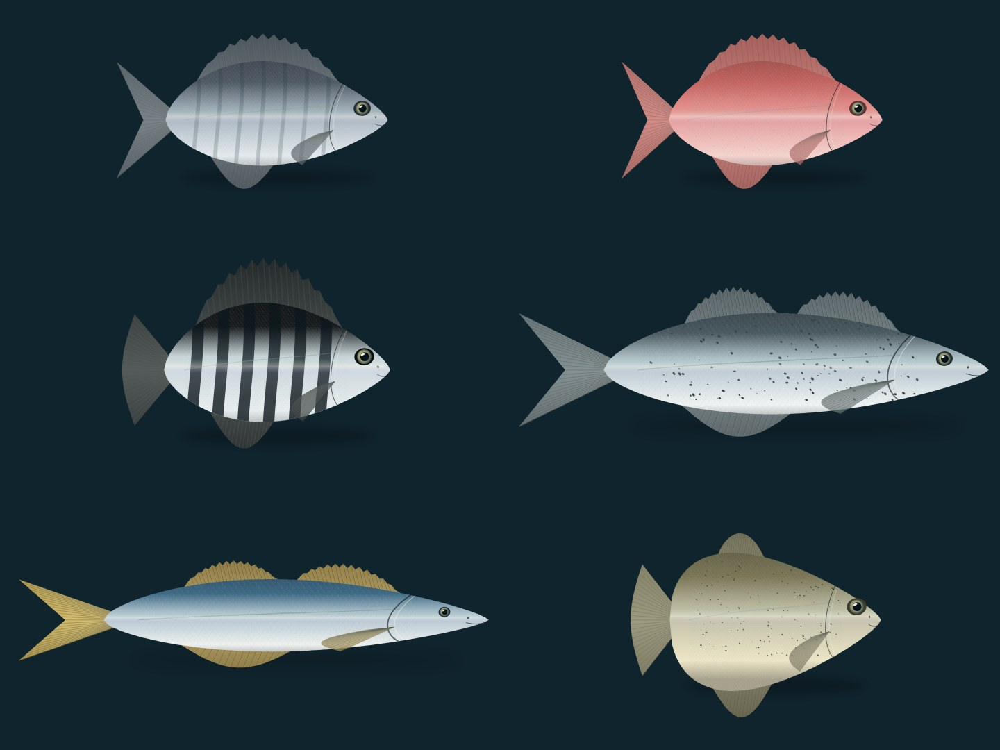

# 바다 찌낚시 그래픽 V2.1

`fishing-demo.html`을 Chrome 또는 Edge에서 열어 시연합니다.

```powershell
Start-Process .\fishing-demo.html
```

오른쪽 **잡은 물고기 미리보기**를 누를 때마다 26종을 순서대로 확인합니다. 실제 조과·보상에는 기록되지 않습니다.

## 물고기 표현 개선

단순한 2D 조과 도형을 Canvas 기반 실사풍 렌더러로 교체했습니다. 어종별 비율·무늬, 비늘, 아가미, 지느러미 줄기, 홍채와 하이라이트, 젖은 표면 반사를 추가했습니다. 결과 그림은 내부 해상도 1200×440이며 도감·조과 목록에도 적용합니다.

사진이 아닌 절차적으로 그린 실사풍 일러스트입니다. 수중 3D 모델은 V2를 유지합니다.



`ait-project/`는 앱인토스 소스입니다. 낮·노을·밤, 날씨, 포인트 선택 및 원본 비교는 시연 파일에 있습니다.

검증: 26종 일반/실루엣 이미지 실제 렌더링, 주요 6종 시각 검토, JavaScript 문법 및 모델 좌표·인덱스 검사 통과. 브라우저 전체 조작과 토스 SDK 빌드는 미검증입니다.
